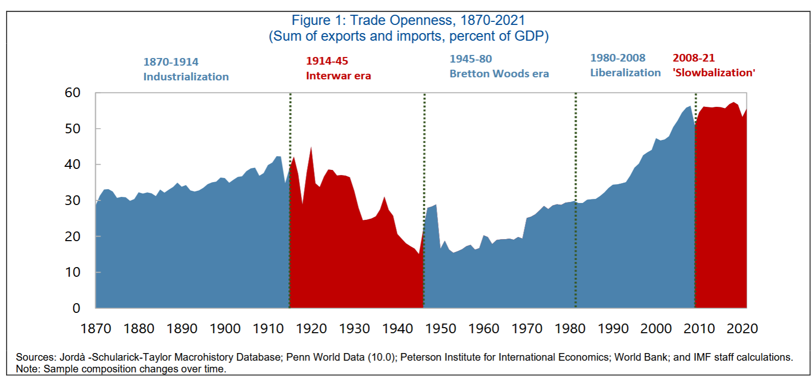
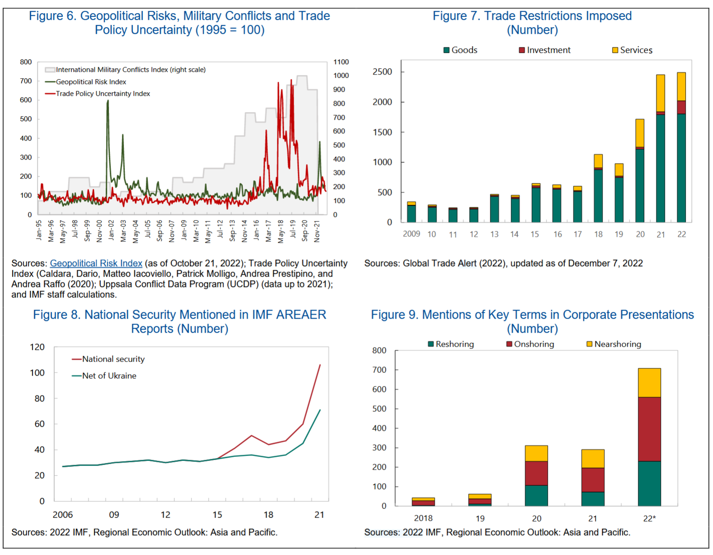
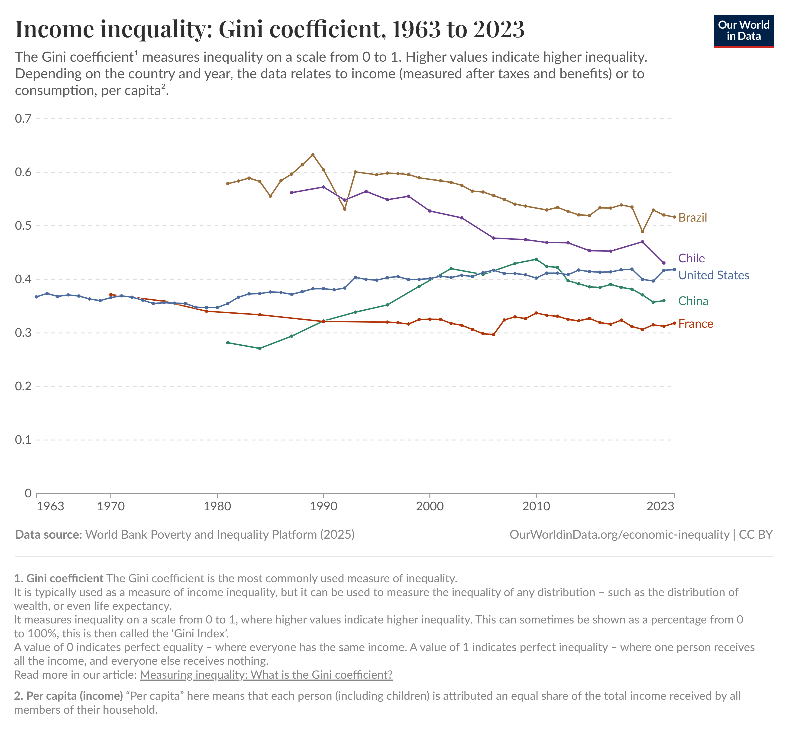
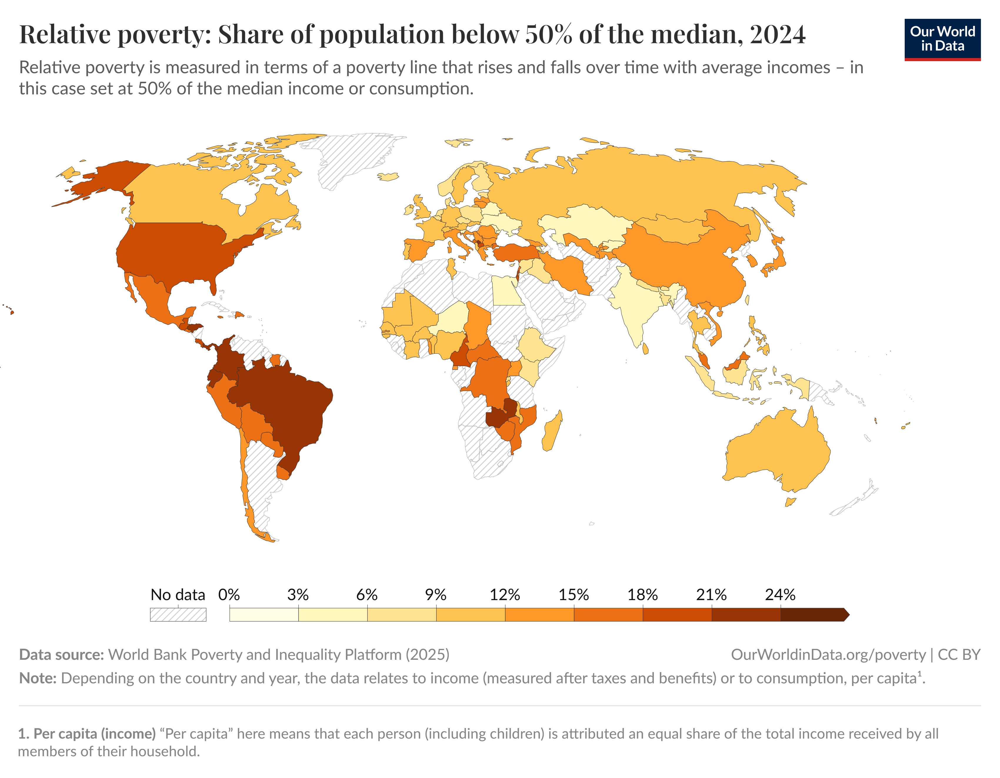
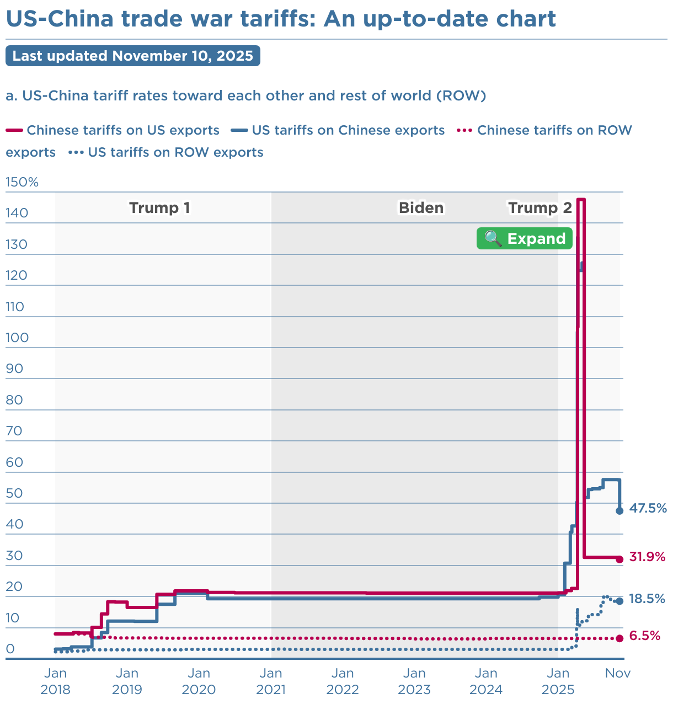
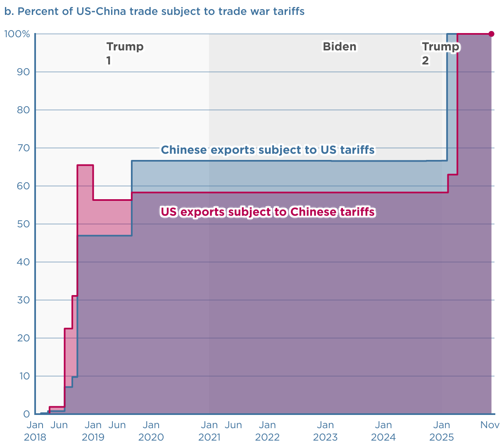
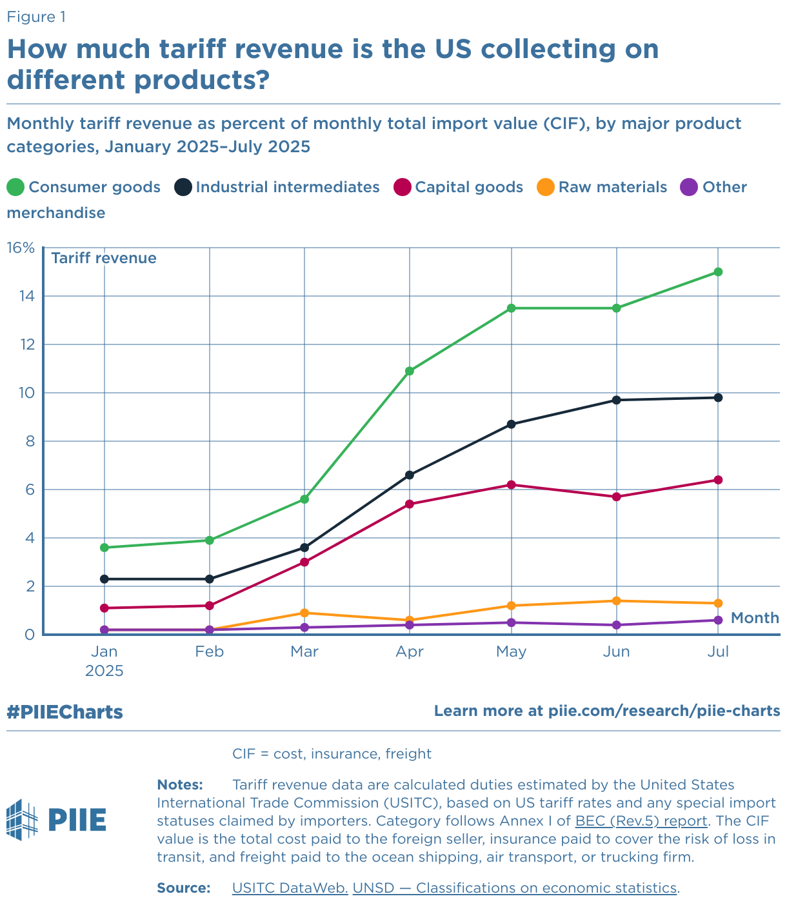
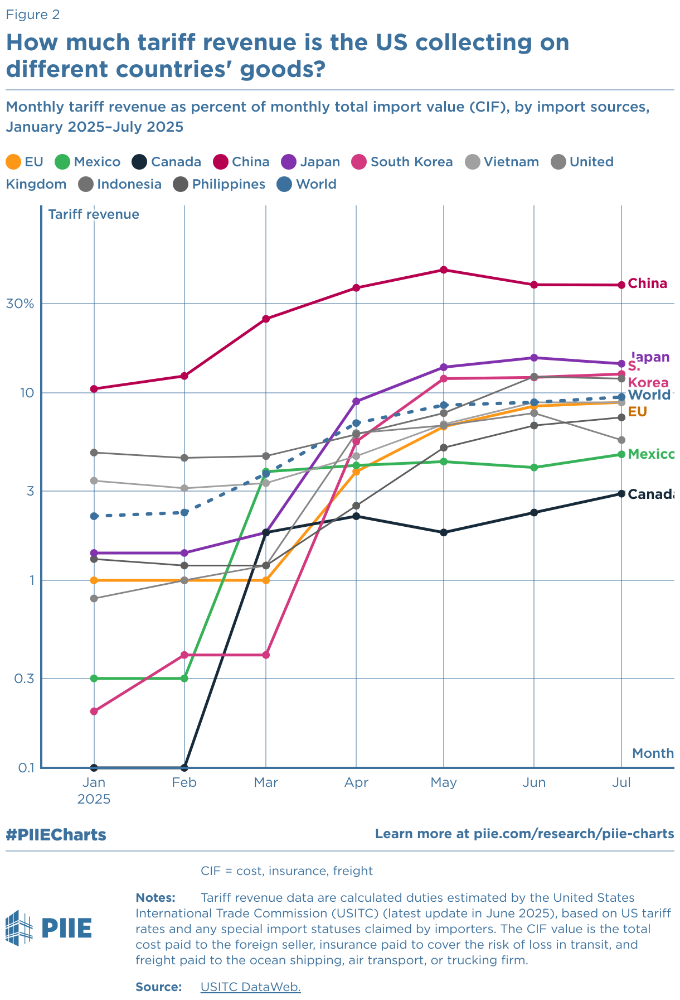
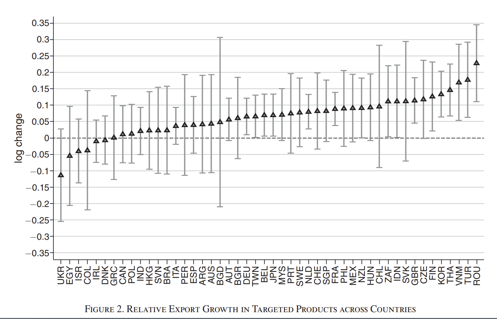

```{r}
#| include: false
library(data.table)
library(ggplot2)
library(ggpubr)
library(scales)
```

## Overview
- Gain from trade 
- Historical case: **US–Japan (1970s–1990s)**  
- Current case: **US–China (2018–present)**  
- Lessons for global supply chains  

## Gain from trade

- National welfare generally increases: higher production frontier, more variety of goods

- Uneven distribution effects
  - import competing sectors vs export sectors
  - small firms vs large firms
  - skilled workers vs unskilled workers
  
- political interests 

## Globalization



## Fragmentation



## US trade deficit

```{r}
df <- fread("../data/06 geopolitics/us_deficit.csv")

# split data: Japan & China vs others
df_jp_cn  <- df[(source!="tiva"|year>2000)
                &region %in% c("JPN", "CHN")]
df_others <- df[(source!="tiva"|year>2000)
                &!region %in% c("JPN", "CHN")]

ggplot() +
  # all other regions in grey
  geom_line(
    data = df_others,
    aes(x = year, y = deficit_gdp, group = region, linetype = region),
    color = "grey80", linewidth = 0.4
  ) +
  # Japan & China with distinct colors
  geom_line(
    data = df_jp_cn,
    aes(x = year, y = deficit_gdp, color = region),
    linewidth = 1
  ) +
  scale_color_manual(
    values = c(JPN = "firebrick", CHN = "steelblue"),
    name = "region"
  ) +
  labs(
    x = "Year",
    y = "Deficit / GDP",
    title = "US Trade Deficit as % of GDP",
    caption = "Source: WIOD, FRED, TIVA"
  ) +
  theme_minimal()
```

## US income inequality

::: columns
::: column

:::
::: column

:::
:::

## US-Japan trade conflicts (1)

- 1950s–1980s: US industry complaints 
  - Cotton products in 1950s, quantity control
  - Other textiles in 1960s, VER
  - Steel, price control (1970s), quantity (1980s)
  - TV sets, anti-dumping surcharge (1970s), VER (1979)
  - Machine tools, price controls (1980s), VER (1986)

## US-Japan trade conflicts (2)

<div style="font-size:90%">
- 1980s~: structural barriers (capital control, keiretsu)
  - Automobile, VER (1981~1994, 3 renewals): price up, FDI 
  - Access to Japanese markets: beef, oranges quotas increased
  - Semiconductor Agreement 1986 (anti-dumping, market access 20%)
  - Super-301: unfair trading partner

- Structural Impediments Initiative (SII) (1989-90)
  - Focus on keiretsu, distribution, standards   

- Plaza Accord (1985): coordinated dollar depreciation
</div>

::: notes
- Semiconductor: retaliatory tariff (1987, 300%), renewed in 1991, adding Korea in 1996
- Yen appreciation: Japanese FDI boom, Asian value chains
**Ref:** Feenstra (1984) Vogel (1996) Ahearne et al. (2003)
:::

## US-Japan Conflicts (3)

- End of conflicts 
  - Stagnation of Japanese business in 1990s and 2000s
  - Other economies in East Asia growing
  - Channels of negotiations
  - WTO's Dispute Settlement Mechanism (anti-dumping, safeguards)

- Emergence of regional FTA  


## China’s Rise and Integration

- WTO accession 2001  
- Deep GVC integration with the U.S.  
- The “China Shock” on U.S. workers (Autor, Dorn & Hanson, 2016):
  - Reductions in both employment and wage levels, a steep drop in households' average earnings
  - Import competition explains 25% aggregate decline in US manufacturing employment

---

## US-China Trade Conflicts (1)

**2018–2019: sectoral tariffs and Chinese retaliation**

- Safeguards on washing machines and solar panels (Jan 2018)
- Steel and aluminum, Section 232: 25% / 10% (Mar 2018)
- Section 301 (IP, forced technology transfer):
  - List 1–2: $50B (Jul–Aug 2018)
  - List 3: $200B, 10% → 25% (Sep 2018 / May 2019)
  - List 4A: ~$120B at 15% (Sep 2019)
- China's retaliation: ~$110B of US goods, targeting soybeans, pork, autos

## US-China trade conflicts (2)

**Structural and tech issues**

- Structural demands: state subsidies, SOEs, forced tech transfer
- Phase One deal (Jan 2020): purchase commitments
- Tech controls (cf. Semiconductor Agreement):
  - ZTE (2018), Huawei Entity List (2019)
  - Advanced-chip export controls (Oct 2022), CHIPS Act (2022)
- China's counter-tools: gallium/germanium (2023), rare earths


## US-China Tariff (1)
::: columns
::: column

:::
::: column

:::
:::

::: notes
- Section 301 tariffs on ~$370B imports  
- China's retaliation  
- Expansion into tech & national security  
:::

## US-China Tariff (2)

::: columns
::: column

:::
::: column
{height=60%}
:::
:::

----

## Effects on US' Price and Consumption

- Import and retaliatory tariffs 
  - declines in imports and exports and import variety
  - complete pass-through of tariffs to consumer
  - increase tariff revenue 
  - gains to domestic producers
  
- Net aggregate real income loss 0.04% of GDP (Fajgelbaum et al., 2020)

## Trade Diversion & Supply Chain Shifts



:::notes
- Countries that operate along downward-sloping supplies whose exports substitute (complement) the United States and China are among the larger (smaller) beneficiaries of the trade war
:::

## Channels of resolution

| | US–Japan | US–China |
|---|---|---|
| Multilateral | WTO dispute settlement, regional FTAs | WTO sidelined |
| Bilateral | SII talks, Semiconductor Agreement | Phase One, truces, Board of Trade |
| Outcome | Conflict faded as Japan stagnated | No off-ramp yet; truce renewed repeatedly |

## Comparing the two episodes
<div style="font-size:70%">

| Issue | US–Japan (1970s–90s) | US–China (2018– ) |
|---|---|---|
| Rivalry | Market share | Tech + geopolitics |
| Triggering sectors | Textiles, steel, TVs, autos, chips | Steel, solar, Section 301 lists, chips |
| Tools | VERs, quotas, yen revaluation | Tariffs, export controls, Entity List |
| Structural demands | Keiretsu, distribution (SII) | Subsidies, SOEs, tech transfer |
| Firm responses | Japan FDI → US/Asia | China FDI → SE Asia |
| Effects | Asian supply chains | Diversification |
</div>

## Takeaways
- Trade restrictions: production relocation  
- Trade policy alone would be distortionary: it shifts trade flows rather than fixing the underlying imbalance  
- GVCs become sticky once established   

---
## References
<div style="font-size:50%">
- Ito and Hoshi (2020) Chapter 13
- Autor, D. H., Dorn, D., & Hanson, G. H. (2013). The China Syndrome: Local Labor Market Effects of Import Competition in the United States. American Economic Review, 103(6), 2121–2168. 
- Fajgelbaum, P. D., Goldberg, P. K., Kennedy, P. J., & Khandelwal, A. K. (2019). The Return to Protectionism (Working Paper No. 25638). National Bureau of Economic Research.
- Fajgelbaum, P., Goldberg, P., Kennedy, P., Khandelwal, A., & Taglioni, D. (2024). The US-China Trade War and Global Reallocations. American Economic Review: Insights, 6(2), 295–312.
- Amiti, M., Redding, S. J., & Weinstein, D. E. (2019). The Impact of the 2018 Tariffs on Prices and Welfare. Journal of Economic Perspectives, 33(4), 187–210. - Aiyar, S., Ilyina, A., Chen, J., Kangur, A., Trevino, J., Ebeke, C., Gudmundsson, T., Soderberg, G., Schulze, T., Kunaratskul, T., Ruta, M., Garcia-Saltos, R., & Rodriguez, S. (2023). Geo-Economic Fragmentation and the Future of Multilateralism. Staff Discussion Notes, 2023(001), 1. 
- Data Link
  - https://www.piie.com/research/piie-charts/2019/us-china-trade-war-tariffs-date-chart
  - https://www.piie.com/research/piie-charts/2025/trumps-tariff-revenue-tracker-how-much-us-collecting-which-imports-are
</div>

