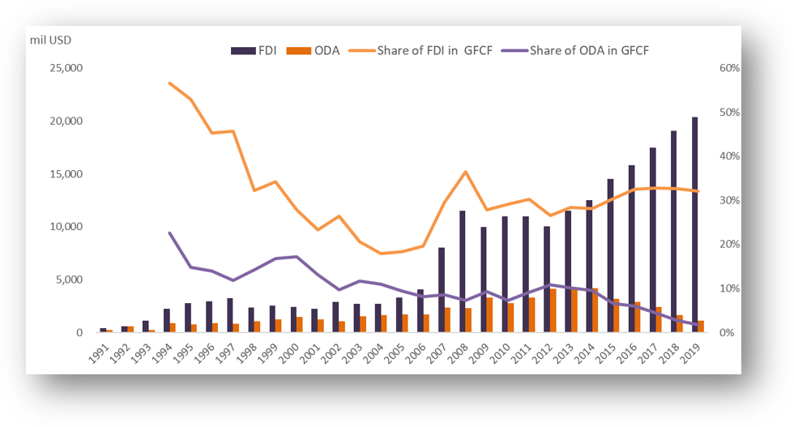

```{r}
#| include: false
library(readxl)
library(ggpubr)
library(scales)
library(data.table)
```


## Objectives

- Outward vs inward FDI 
- Identify barriers to inward FDI
- Compare commercial and strategic investment logic against official development assistance (ODA)

## Key Concepts

- Foreign Direct Investment (FDI)
- Mergers & Acquisitions (M&A)
- Multinational Enterprises (MNEs)

## Roadmap

- Concepts: FDI, M&A, MNEs
- Trends: outward FDI from ASEAN, manufacturing and services
- Barriers: what holds back inward FDI
- Logic: commercial and strategic investment vs. ODA

## Overview: FDI and ODA
```{r}
world = fread("../data/08 fdi/world_fdi_oda.csv")
ggarrange(
  ggline(world[!grepl("outflows",indicator)],
         x="date",xlab="",
         numeric.x.axis = T,
         y="value",ylab="value (current US$)",
         color = "indicator",
         caption = "Source: World Bank") +
    scale_y_continuous(labels = label_number(scale = 1e-12, suffix = "tr")),
  ggline(world[!grepl("outflows",indicator)],
         x="date",xlab="",
         numeric.x.axis = T,
         y="gdp_share",ylab="GDP share (%)",
         color = "indicator",
         caption = "Source: World Bank") +
  scale_y_continuous(labels = label_number(scale = 100, suffix = "%")),
  common.legend =T
) %>% annotate_figure(top = "Global Flow")
```

::: notes
- Recap of lecture 1: ODA is public, concessional, development-oriented.
- Today: FDI is private and profit-seeking; compare scale and GDP share.
:::

## Key concepts: FDI, M&A, MNEs

- FDI: cross-border investment with a lasting interest and control (commonly a 10% voting-share threshold)
  - Forms: greenfield, M&A, reinvested earnings
- M&A: acquiring or merging with an existing foreign firm, rather than building new capacity
- MNEs: firms that own and control operations in more than one country; the main actors behind FDI
- Motives: market-seeking, resource-seeking, efficiency-seeking

## FDI vs. portfolio investment

- **Direct investment:** lasting interest and influence over management of a foreign enterprise (typically 10% or more of voting power).
- **Portfolio investment:** cross-border holdings of securities without a direct-investment relationship.
- Direct investment is closely linked to multinational production and global value chains; portfolio flows are generally more liquid and volatile.

::: notes
- In the balance of payments, both direct and portfolio investment are recorded in the financial account.
- The Balance of Payments lecture shows that Japan's portfolio flows have been more volatile than direct investment flows.
:::

## Japan's direct investment: Outward vs. inward

```{r}
#| include: false
# Units: assumed 100 million yen (BOJ/MOF convention); dividing by 1e4 gives trillion yen. Confirm against the source.
boj = fread("../data/08 fdi/boj_investment.csv")
setnames(boj, c("year", "Direct_out", "Portfolio_out", "Direct_in", "Portfolio_in"))
boj = boj[grepl("^[0-9]{4}$", year)]
boj = boj[, lapply(.SD, as.numeric)]
bcols = setdiff(names(boj), "year")
boj[, (bcols) := lapply(.SD, function(x) x / 1e4), .SDcols = bcols]
boj_di = melt(boj[, .(year, Outward = Direct_out, Inward = Direct_in)],
              id.vars = "year", variable.name = "Direction")

ggline(boj_di,
       x = "year", xlab = "",
       numeric.x.axis = T,
       y = "value", ylab = "Trillion yen",
       color = "Direction",
       title = "Japan: Direct investment, outward (assets) vs. inward (liabilities)",
       caption = "Source: Bank of Japan, Balance of payments")
```

::: notes
- Cumulative 1996–2025: outward roughly 370 trillion yen vs. inward roughly 58 trillion yen (about 6x), assuming units of 100 million yen.
- Japan is a large net outward investor; inward FDI stays small relative to GDP. Use this to lead into "barriers to inward FDI".
:::

## Japan's outward direct investment: Components

```{r}
#| include: false
# MOF series (outward only); used for the breakdown because the BOJ file has no components.
fdi_jp = fread("../data/08 fdi/mof_fa.csv")
setnames(fdi_jp, trimws(names(fdi_jp)))
fdi_jp = fdi_jp[, .(year,
                    Total = `Direct investment`,
                    `Equity (excl. reinvested earnings)` = `Direct investment: Equity other than reinvestment of earnings`,
                    `Reinvestment of earnings` = `Direct investment: Reinvestment of earnings`,
                    `Debt instruments` = `Direct investment: Debt instruments`)]
cols = setdiff(names(fdi_jp), "year")
fdi_jp[, (cols) := lapply(.SD, function(x) x / 1e4), .SDcols = cols]
```

```{r}
#| eval: false
#| include: false
ggline(fdi_jp,
       x = "year", xlab = "",
       numeric.x.axis = T,
       y = "Total", ylab = "Trillion yen",
       title = "Japan: Direct investment, 1996–2024",
       caption = "Source: Ministry of Finance, Financial account")
```


```{r}
fdi_comp = melt(fdi_jp[, !"Total"], id.vars = "year",
                variable.name = "Component")
ggbarplot(fdi_comp,
          x = "year", xlab = "",
          y = "value", ylab = "Trillion yen",
          color = "Component",
          fill = "Component",
          x.text.angle = 90,
          legend = "right",
          title = "Japan: Direct investment by component",
          caption = "Source: Ministry of Finance, Financial account")
```


## Japan's capital liberalization and FDI

- **Before the 1970s:** strict controls on capital transactions.
- **1970s:** gradual liberalization of inward direct and portfolio investment.
- **1980:** foreign exchange regime shifted from generally prohibited unless permitted to generally free unless restricted.
- **1980s–1990s:** further liberalization of outward investment and foreign borrowing.
- **Discussion:** Why might inward FDI remain limited even after legal restrictions are relaxed?

::: notes
- Adapted from the capital controls and liberalization timeline in the Balance of Payments lecture.
- Legal openness does not automatically eliminate business costs, hiring difficulties, or other barriers.
:::

## Barriers to inward FDI

<div style="font-size:65%">

| Reported barrier | 2012 (%) | 2016 (%) |
|---|---:|---:|
| High cost of doing business | 78.6 | 74.6 |
| Distinctiveness of the Japanese market | 43.1 | 46.6 |
| Difficulty securing personnel | 34.1 | 45.7 |
| Strict regulations and permits | 36.7 | 32.1 |
| Complicated administrative procedures | 33.7 | 28.6 |

Source: Hoshi (2018), Table 1, based on METI surveys of foreign affiliates.

</div>

::: notes
- These are selected responses from the 2012 and 2016 surveys, not a comprehensive ranking of all barriers.
- The reported difficulty securing personnel increased between surveys.
- Connect this Japan case to the broader regulatory, infrastructure and institutional barriers in the next slide.
:::

## Japan's inward FDI and business environment

```{r}
#| message: false
#| warning: false
# Data used in the Balance of Payments lecture; place a copy at this relative path.
fdi_business = fread("../data/08 fdi/fdi_dtf.csv")
reference_countries = c("Luxembourg", "Ireland", "Netherlands", "United States", "China", "Argentina", "Brazil", "Korea")
ggplot(fdi_business, aes(Inward_FDI, Business_Index)) +
  geom_point(color = "gray70") +
  geom_point(data = fdi_business[Country == "Japan"], color = "red", size = 3) +
  geom_text(data = fdi_business[Country == "Japan"], aes(label = Country), vjust = -1, color = "red") +
  geom_text(data = fdi_business[Country %in% reference_countries], aes(label = Country), vjust = -1, color = "gray40", size = 3) +
  scale_x_log10() + scale_y_log10() +
  labs(title = "Inward FDI vs. Doing Business Score", x = "Inward FDI (% of GDP, log; 2015–2024 average)", y = "Doing Business Score (log; 2019–2020 average)", caption = "Source: OECD, World Bank; adapted from Balance of Payments lecture") +
  theme_minimal()
```

::: notes
- The original lecture emphasizes Japan's relatively low inward FDI compared with other advanced economies.
- This is a descriptive cross-country comparison, not evidence that the business score causes FDI.
:::


## Investment logic: FDI vs. ODA

<div style="font-size:60%">
| **Aspect** | **Commercial FDI** | **Strategic investment** | **ODA** |
|---|---|---|---|
| **Main actor** | Private firms (MNEs) | State-linked firms, state-backed investors | Official agencies |
| **Objective** | Profit, market access, efficiency | Supply security, influence, geopolitical position | Development and welfare of recipients |
| **Terms** | Market-based returns | Returns may be secondary to strategic gain | Concessional (grant element) |
| **Risk appetite** | Avoids high-risk, low-return locations | May accept lower returns for strategic reasons | Goes where private capital avoids |
| **Link to recipient** | Follows investment climate | Shapes it to its own ends | Builds preconditions for investment |
</div>

::: notes
- Table is a framing device; adapt the "strategic" column to the cases you plan to discuss.
:::

## ODA and FDI relationship

<div style="font-size:50%">
- Infrastructure & human capital improvement → lower investment costs
- Institutional reforms & risk reduction → improved investment climate
- Policy dialogue & technical cooperation → regulatory harmonization
</div> 



## Complementarity vs. Substitution

- Complementary view:
  - ODA builds preconditions for private investment (infrastructure, governance).
  - Especially in low-income countries where private capital avoids risk.

- Substitution view:
  - Excessive aid can crowd out FDI if it distorts markets or maintains uncompetitive sectors.
  - Conditionality or tied aid may limit spillovers.

## Japan’s Experience

<div style="font-size:80%">
- Tied aid and “ingredients approach” → enabled Japanese firms to invest later.
- Evidence: Ono and Sekiyama (2023) on the effect of ODA on FDI by aid type
- Case study: Vietnam (Tsuno, 2023)
- Transition from aid-recipient to investment-partner relationship.
</div> 

::: notes
- Check that the Ono and Sekiyama (2023) finding matches the bullet above before presenting; the original deck cited it only in references.
:::

## Future Directions

- Align ODA with investment climate improvement (connectivity, legal reform)
- Promote Aid for Trade and Public-Private Partnerships (PPPs)
- Ensure transparency to avoid tied-aid distortions

## References
<div style="font-size:30%">
- Burnside, C. & Dollar, D. 2000, 'Aid, policies, and growth', American economic review, 90 (4).
- Nguyen, H. P., Huynh, A. N. Q., Reisach, U., & Kim, X. L. T. 2022. How does Japanese ODA really contribute to economic growth for ASEAN countries? Journal of International Economics and Management, 22(2).
- MOFA, 2023, White Paper on Development Cooperation 2023
- Ono, S., & Sekiyama, T. (2023). Differences in impact of official development assistance on foreign direct investment by aid types. Frontiers in Political Science, 5. 
- Hoshi, T. (2018). Has Abenomics succeeded in raising Japan’s inward foreign direct investment? Asian Economic Policy Review, 13(1), 149–168.
- Tsuno, M., 2023, The Role of Japanese Official Development Assistance in Viet Nam’s Socio-economic Development. In Viet Nam 2045: Development Issues and Challenges, (Kimura, F. et al, pp. 53–97). ERIA.
- Data link
  - https://data.worldbank.org/indicator/NY.GDP.MKTP.CD
  - https://data.worldbank.org/indicator/BX.KLT.DINV.CD.WD
  - https://data.worldbank.org/indicator/DT.ODA.ALLD.CD
  - https://data.worldbank.org/indicator/BX.TRF.PWKR.CD.DT
</div>
