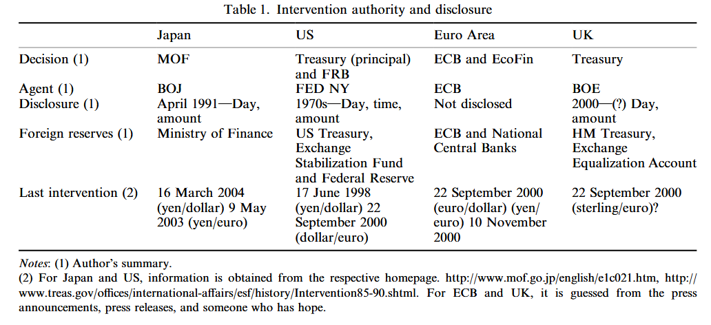

```{r}
#| include: false
library(data.table)
library(ggplot2)
library(ggpubr)
library(scales)
```

# Measuring the yen

## A Japanese exporter's invoice

The exchange rate is the price of one currency in another. A fall from **?150 to ?140 per US dollar** means the yen strengthens.

A Japanese exporter invoices a US customer for **US$1,000**. How many yen does the exporter receive at each rate?

::: {.incremental}
- At ?150 per dollar, the invoice converts to **?150,000**. At ?140, it converts to **?140,000**.
- Did the Japanese product also become more expensive relative to a US product?
:::

::: notes
- Assume the invoice stays fixed in dollars and the exporter converts the payment into yen.
:::

## The yen against the dollar and euro

```{r}
ex=fread("../data/10 exchange/AEXJPUS.csv",col.names = c("date","ex"));
exEU=fread("../data/10 exchange/CCEUSP01JPA651N.csv",col.names = c("date","ex"));
ex[,currency:="USD"]
exEU[,currency:="Euro"][,ex:=100/ex]
ex2 = rbind(
  data.table(
    date = as.IDate(paste0(1949:1971, "-01-01")),
    ex   = 360,
    currency = "USD"), 
  ex,
  exEU)[order(date)]

ggplot(ex2, aes(date, ex,color=currency)) +
  geom_line() +
  labs(x="Year", y="JPY", colour="",
       title="Nominal Exchange Rate",
       caption = "Source: FRED") +
  theme_minimal()
```

::: notes
- During 2000, the USD/JPY moved little, the yen appreciated against the euro: depreciation of the euro against both the dollar and yen.
:::

## Purchasing power parity (PPP)

::: {.slide-font-size style="--slide-font-size: 75%"}
$$ q_t = S_t \times \frac{P_{US,t}}{P_{JP,t}} $$

::: {.nonincremental}
- $S_t$: nominal exchange rate, **yen per dollar** (USD/JPY)
- $q_t$: price of US goods relative to Japanese goods, both in yen
- **Absolute PPP:** $q = 1$. The same basket costs the same in both countries.
- **Relative PPP:** $q$ stays constant as changes in $S$ offset the inflation gap.
- A higher $q$ means a **weaker yen in real terms** and cheaper Japanese goods relative to US goods.
:::
:::

::: notes
- To express the real exchange rate as an index, divide $q_t$ by its base-year value and multiply by 100.
In the apple example, $q = 1$ in the base year, so the index starts at 100.
:::

## PPP: an apple example

::: {.slide-font-size style="--slide-font-size: 72%"}
At **¥100 per US dollar**, both apples cost ¥100. At parity, $q = 1$ and the real exchange rate index is **100**.

| Scenario | US apple | Japan apple | Yen per dollar | Real rate index |
|---|---:|---:|---:|---:|
| Base year | $1 | ¥100 | 100 | 100 |
| US price doubles | $2 | ¥100 | 100 | **200** |
| Japan price doubles | $1 | ¥200 | 100 | **50** |
| Both prices double | $2 | ¥200 | 100 | **100** |
| US price doubles, yen strengthens | $2 | ¥100 | 50 | **100** |

If the yen strengthens and US prices rise faster than Japanese prices, what happens to Japan's price competitiveness?
:::

::: notes
- The last row is the key point: if relative PPP holds, nominal appreciation just 
compensates for higher foreign inflation, and competitiveness does not change.
- Ask which effect is larger. Yen appreciation lowers $q$, while faster US inflation raises it. 
Japan's price competitiveness improves if $q$ rises.
- Link to the next slides: a gap between inflation rates makes nominal and real exchange rates diverge. 
Japan's deflation since the 1990s pushed the real rate to depreciate even when the nominal rate did not move.
:::

## Nominal vs real exchange rate

```{r}
ex=fread("../data/10 exchange/AEXJPUS.csv",col.names = c("date","ex"));
us=fread("../data/10 exchange/CPALTT01USA657N.csv",col.names = c("date","yus") );
jp=fread("../data/10 exchange/CPALTT01JPA657N.csv",col.names = c("date","yjp"))

dt=Reduce(function(x,y)merge(x,y,"date"),list(ex,us,jp))
setorder(dt, date)
dt[, `:=`(us_prices = cumprod(1 + yus / 100),
          jp_prices = cumprod(1 + yjp / 100))]
dt[, real_rate := ex * us_prices / jp_prices]

series_labels = c(ex = "Nominal rate (yen per dollar)",
                  real_rate = "Real rate",
                  us_prices = "US CPI",
                  jp_prices = "Japan CPI")
base_year = format(dt$date[1], "%Y")
m = melt(dt, id.vars = "date", measure.vars = names(series_labels),
         variable.name = "series", value.name = "value")
m[, index := 100 * value / value[1], by = series]
m[, series := factor(series, levels = names(series_labels), labels = unname(series_labels))]
ggplot(m, aes(date, index, colour = series)) +
  geom_line() +
  labs(x="Year", y=paste0("Index (", base_year, " = 100)"), colour="",
       subtitle="For both exchange rates, a higher index means a weaker yen",
       caption = "Source: FRED") +
  theme_minimal()

```

::: notes
- When US prices rise faster than Japanese prices, the real rate rises relative to the nominal rate, 
as in the apple example.
:::

## NEER and REER

- **NEER** combines the yen's bilateral exchange rates using trade weights.
- **REER** adjusts for prices in Japan and its trading partners before combining the rates.
- Both are trade-weighted geometric averages expressed as indices.

::: notes
- See the [Bank of Japan's methodology](https://www.boj.or.jp/en/statistics/outline/exp/exrate02.htm).
:::

# Japan's price competitiveness

## The yen and Japan's productivity

How could Japan remain price-competitive while the yen appreciated in real terms?

```{r}
eer=fread("../data/10 exchange/boj_eer.csv",skip=1);
setnames(eer,colnames(eer)[1],"date")
eerl = melt(eer,id.vars="date")

pwt = fread("../data/01 intro/growth.csv")
ctys = c("JPN","USA")

ggarrange(
  ggplot(pwt[grepl("TFP",Variablename2)&ISOcode%in%ctys],
       aes(date,gyoy,color=ISOcode)) +
  geom_line() +
  labs(x="Year", y="Growth", colour="",
       title="TFP change",
       caption = "Source: PWT") +
  theme_minimal() +
  theme(legend.position = "bottom"),
  ggplot(eerl[!is.na(value)],
       aes(date,value,color=variable)) +
  geom_line() +
  labs(x="Year", y="EER", colour="",
       title="Effective Exchange Rates",
       subtitle="Higher index = stronger yen",
       caption = "Source: BOJ") +
  theme_minimal() +
  theme(legend.position = "bottom"),
  ncol = 2
)
```

::: notes
- In 1973-95, compare yen appreciation with Japan's productivity growth. 
Productivity gains can help firms contain costs even when the yen strengthens.
- In the later period, ask how lower inflation in Japan than abroad can contribute to real depreciation.
- The charts motivate these explanations. They do not isolate the effect of either factor on trade.
:::

## Trade and overseas production

- effects on trade through the relative price of goods
  - 2000s~: yen exchange rate as important factor for Japan's competitiveness (Ito and Shimizu, 2015)

- effects on foreign direct investment
  - reallocate production from Japan to Asia due to yen appreciation (Golderg and Klein, 1996)

## Current account balances

Japan, the US, and the euro area have different balances. What else would you need to explain them?

```{r}
df = fread("../data/09 bop/imf_ca.csv",header = T)
df = melt(df,id.vars="region",variable.factor = F)
df[,value:=as.numeric(value)]
df[,variable:=as.integer(variable)]

keep = c("Japan","Euro area","United States")
plot_df = df[region%in%keep&!is.na(value)]

ggplot(plot_df[variable<=2024], 
       aes(variable, value,
           group = region, 
           colour = region, 
           size = region == "Japan")) +
  geom_hline(yintercept = 0, linetype = "dashed") +
  geom_line() +
  scale_size_manual(values = c(`TRUE` = 1.2, `FALSE` = 0.6), guide = "none") +
  scale_y_continuous(labels = function(x) paste0(x, "%")) +
  labs(x = NULL, y = "% of GDP", colour = NULL,
       caption = "Source: IMF WEO") +
  theme_minimal(base_size = 12) +
  theme(legend.position = "bottom") 
```

# What moves the yen?

## Bretton Woods system

- Competitive devaluation in the 1930s meant officially lowering a currency's value under a fixed regime.

- After WWII
  - tied to USD, then to gold
  - 360 yen/dollar: 1949-1971

- Trade balance mirrored balance in foreign reserves: costly to maintain fix exchange rates

::: notes
- trade deficits means lack of foreign reserves, leading to reduce imports and could hurt the economy
- USD devaluation then to main fix exchange rates, Yen needs devaluation, buying USD and selling Yen
:::

## The shift to floating rates

- Issues with the fixed systems:
  - Slow adjustment of the rate to changes in fundamentals
  - US trade deficit: USD abroad outweight US's gold reserve

- US suspended the convertibility of the dollar in 1971 and devaluated the dollar in 1973

- Under floating rates, a fall in a currency's value is called **depreciation**.

::: notes
- USD overvalued but JPY and German mark undervalued: 
Japan’s and Germany’s productivity growth was higher than that of the US
- As capital controls were lifted in the second half of the 1970s and 1980s in Japan, 
capital flows became more important factors that influence the exchange rate
:::

## Exchange Rate Dynamics

- long run: fundamentals (interest rates, money supplies, productivity growth)
  - carry trade practice

- short-run: arrival of new information regarding these fundamentals (not the actual changes)

::: notes
- interest rate declines: discourage capital inflows 
and encourage capital outflows: home currency depreciates
- low interest rate in yen by borrowing in yen and 
investing in a high-interest-rate currency: carry trade
- prevalent in Japan and the yen in the 1990s and 2000s, 
until interest rates in all advanced countries collapsed to near zero after the global financial
:::

## Intervention

- Authorities buy or sell yen against foreign currency to influence the exchange rate.
- Fixed regimes intervene to defend the peg. Floating regimes may intervene occasionally.

::: {.slide-font-size style="--slide-font-size: 75%"}
| Unsterilized operation | Impact on yen monetary base | Intended effect |
|---|---|---|
| Sell yen, buy foreign currency | Expands | Weaken the yen |
| Buy yen, sell foreign currency | Contracts | Strengthen the yen |
:::

::: notes
- In an unsterilized operation, changes in the monetary base can affect domestic interest rates.
- Sterilization offsets the change in the monetary base. 
Intervention can still affect the mix of assets held by investors or signal future policy.
:::

## Who decides when to intervene?

{width=100%}

## Japanese Intervention

- Intervention frequency declined over time
- Intervention sizes spiked in 1978, 1987, 1989, and 2003–04
- yen-selling interventions were more common than yen-buying 
- authorities sold yen when it was strong/appreciating and bought yen when it was weak/depreciating

::: notes
- Plaza Accord (1985): selling dollars/buying yen
- Louvre Accord (1987): buying dollars/selling yen
- 2003-04 interventions: selling yen
:::

## Discussions

- Can a stronger yen improve price competitiveness?
- Can the exporter receive fewer yen while Japanese goods become relatively cheaper?


# Appendix: The yen's international role

## Invoicing currency

- Share of yen-invoicing in Japan's exports: 
  - US: 10–20%
  - EU: 30%
  - Asia: 40-50% (re-exported to US and EU)
  
- Share of yen-invoicing in Japan's imports:
  - US and Asia: 30%
  - EU: 60%

## Currencies traded in FX markets

```{r}
bis = fread("../data/10 exchange/publication_table_bis.csv")
setnames(bis,"V1","Currency")
bis = melt(bis,
           id.vars = "Currency",
           measure.vars = patterns("\\%"),
           value.name = "Turnover",
           variable.name = "Year")
cur_codes <- c("USD", "EUR", "JPY", "GBP","CNY")
bis[, Year := as.integer(gsub("_%$","",Year))]
bis = bis[!is.na(Turnover) & !is.na(Currency)]

ggplot(bis[Currency%in%cur_codes], 
       aes(x = Year, y = Turnover, colour = Currency)) +
  geom_line(size = 1) +
  geom_point(size = 1.8) +
  labs(
    title = "FX Turnover – Top 5 Currencies (BIS Triennial Survey)",
    x = "Year (survey)",
    y = "Daily average turnover share (%)",
    colour = "Currency"
  ) +
  theme_minimal()

```

## Foreign Reserve Currency

```{r}
imfd = fread("../data/01 intro/imf.csv")
curr = unique(imfd[,.(V1=sum(value)),
                   by=Currency][order(-V1),Currency])
curr = c("Japanese yen",curr[curr!="Japanese yen"])
curr_col = c("black",get_palette(palette = "default",length(curr)-1))
imfd[,Currency:=factor(Currency,levels = curr)]
ggbarplot(imfd[!is.na(value)],
          x="year",xlab = "",
          y="value",ylab = "",
          fill = "Currency",
          palette = curr_col) +
  scale_y_continuous(labels = label_number(suffix = "%")) +
  guides(fill = guide_legend(nrow = 3))+
  theme_pubclean()+
  theme(axis.text.x = element_text(angle = 90, vjust = 0.5, hjust = 1)) 
```

## References

<div class="slide-font-size" style="--slide-font-size: 50%">
- Ito and Hoshi (2020) Chapter 12 
- Ito, K., & Shimizu, J. (2015). Industry-Level Competitiveness, Productivity and Effective Exchange Rates in East Asia. Asian Economic Journal, 29(2), 181–214.
- Linda S. Goldberg & Michael W. Klein, 1996. "Foreign direct investment, trade, and real exchange rate linkages in developing countries," Proceedings, Federal Reserve Bank of San Francisco, pages 73-100.
- Song, C.-Y. (1997). The Real Exchange Rate and the Current Account Balance in Japan. Journal of the Japanese and International Economies, 11(2), 143–184.
- Toru Iwami (2025) "The Internationalization of Yen and Key Currency Questions", IMF Working Papers 1994, 041 (1994)
- Data Link
  - https://fred.stlouisfed.org/series/CPALTT01JPA657N
  - https://fred.stlouisfed.org/series/CPALTT01USA657N
  - https://fred.stlouisfed.org/series/AEXJPUS
  - https://fred.stlouisfed.org/series/CCEUSP01JPA651N
  - https://www.stat-search.boj.or.jp/ssi/cgi-bin/famecgi2?cgi=$nme_a000_en&lstSelection=FM09
  - https://www.customs.go.jp/toukei/shinbun/tuuka.html
</div>
