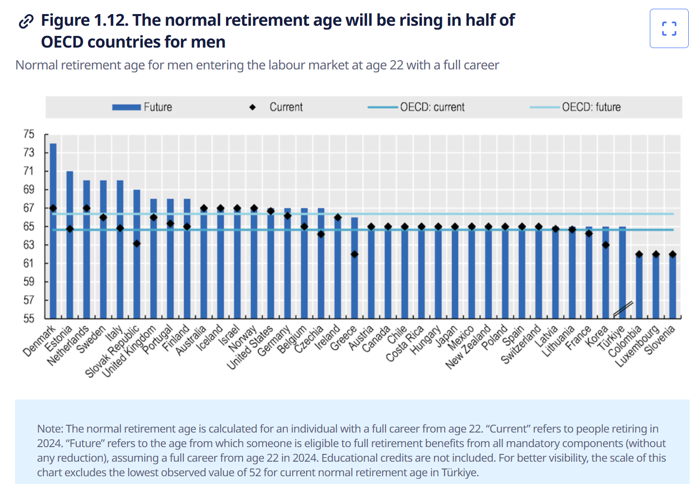
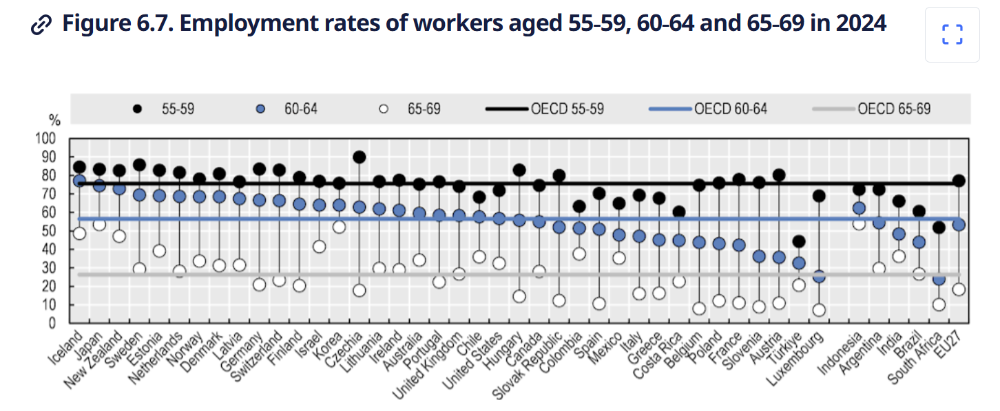
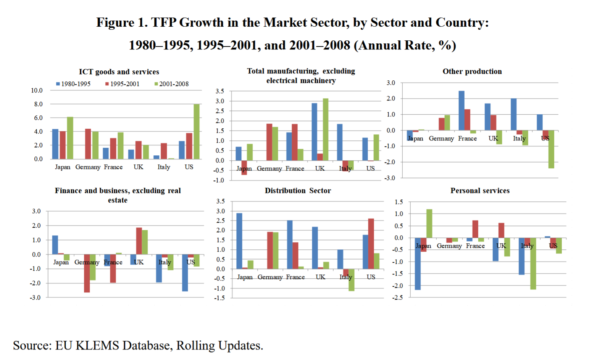
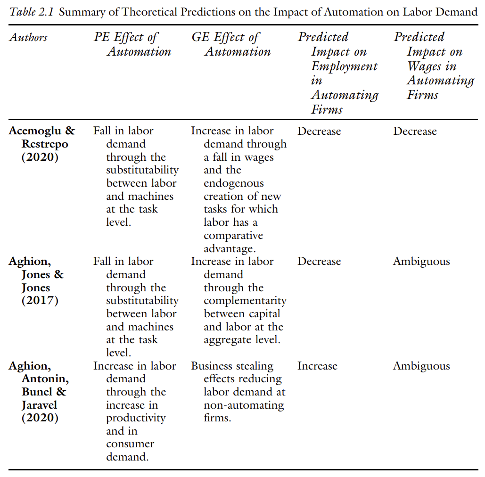

```{r}
#| include: false
library(data.table)
library(ggpubr)
library(scales)
```

# Japan's changing population

## Japan's demographic challenge

**If Japan's working-age population shrinks, can living standards still rise and pensions remain sustainable?**

Look for three things as we go through the data.

- How Japan's population and age structure changed
- How those changes affect growth, saving, and pensions
- Which policy responses address each effect

## Japan's total and working-age populations

```{r}
pop = fread("../data/11 aging/wb_pop.csv")

# Prepare data
pop2 = pop[country=="Japan"]
pop2[,max_value:=max(value),by=indicator]
pop2[,lab:=ifelse(value==max_value,round(value/10^6,0),"")]
pop2_lab = pop2[lab!="",.(value,date,indicator,
                          label=paste0(date,":",
                                       round(value/10^6,0),"M"))]

ggplot(pop2, aes(x = date, y = value,
                color = indicator)) +
  scale_y_continuous(
    labels = label_number(scale = 1e-6, suffix = "M")) +
  geom_line(size = 1) +
  geom_segment(
    data = pop2_lab,
    aes(x = date, xend = date,
        y = 0, yend = value,
        color = indicator),
    linewidth = 0.7,
    linetype = "dashed"
  ) +
  # labels at top of vline
  geom_text(
    data = pop2_lab,
    aes(x = date, y = value,
        label = label),
    vjust = -0.5,
    size = 3.2
  ) +
  labs(x = "", y = "",
       caption = "Source: World Bank", color = NULL) +
  theme_minimal() +
  theme(
    legend.position = "top",   # remove legend
    axis.text.x = element_text(angle = 0, hjust = 1))+
  coord_cartesian(clip = "off")        # allow labels to extend outside plot
```

## Population growth, fertility, and migration

```{r}
birth = fread("../data/11 aging/un_pop_birth.csv")
indicators = c("Population Growth", "Total Fertility Rate", "Net Migration Rate")
units = c("Population growth (% per year)",
          "Fertility (births per woman)",
          "Net migration (per 1,000 people)")
japan = birth[Country == "Japan" & date <= 2050 & variable %in% indicators]
japan[, panel := factor(variable, levels = indicators, labels = units)]

ggplot(japan, aes(date, value)) +
  geom_vline(xintercept = 2024, colour = "grey65") +
  geom_line(data = japan[date <= 2023], colour = "#24566c", linewidth = 0.8) +
  geom_line(data = japan[date >= 2023], colour = "#24566c",
            linewidth = 0.8, linetype = "dashed") +
  facet_wrap(~panel, nrow = 1, scales = "free_y") +
  labs(x = NULL, y = NULL,
       subtitle = "Dashed lines show projections from 2024",
       caption = "Source: UN World Population Prospects 2024") +
  theme_minimal(base_size = 12)
```

::: notes
- Population change reflects births, deaths, and net migration.
Fertility is measured in births per woman and helps explain births over time.
- Each panel has its own scale. The lines show the direction and timing of changes in Japan.
:::

## Old-age dependency ratio

```{r}
age = fread("../data/11 aging/wb_age_depend.csv")

# Prepare data
age[, is_japan := ifelse(country == "Japan", "Japan", "Others")]

# Last observation per country for labeling
lab = age[date==max(date),.(date,value,country,is_japan)]

ggplot(age, aes(x = date, y = value,
                color = is_japan,
                linetype = country,
                group = country)) +
  geom_line(size = 1) +
  geom_text(
    data = lab,
    aes(label = country, color = is_japan),
    hjust = -0.1,              # move label slightly to the right
    vjust = 0.5,
    size = 3
  ) +
  scale_color_manual(values = c("Japan" = "red", "Others" = "gray70")) +
  scale_linetype_manual(
    values = rep(c("solid","dashed","dotdash","twodash","longdash"),
                 length.out = length(unique(age$country)))
  ) +
  labs(x = NULL, y = "People aged 65+ per 100 aged 15–64",
       caption = "Source: World Bank") +
  theme_minimal() +
  theme(
    legend.position = "none",   # remove legend
    axis.text.x = element_text(angle = 0, hjust = 1),
    plot.margin = margin(5, 40, 5, 5)   # extra right margin so labels not cut
  ) +
  coord_cartesian(clip = "off")        # allow labels to extend outside plot
```


::: notes
- This is the old-age dependency ratio. It compares age groups.
The number of actual workers and pension recipients depends on employment and eligibility.
:::

# Economic effects

## How aging affects the economy

- **Growth.** A smaller workforce can slow total GDP growth. Higher output per worker or higher employment can still raise real GDP per person.
- **Saving.** Retirement can change how much households save or draw down. The national saving rate also reflects firms and government.
- **Pensions.** A smaller contributor base relative to beneficiaries puts pressure on a pay-as-you-go system.

::: notes
- Real GDP per person equals real GDP divided by total population.
A country can produce less in total while producing more per person if population falls faster than output.
:::

## What drives Japan's GDP growth?

```{r}
jpl = fread("../data/11 aging/japan_growth.csv")
jpl[variable=="lf_ratio",variable:="Participation Rate"]
jpl[variable=="pop",variable:="Population"]

ggplot() +
  # Bars for other variables
  geom_col(
    data = jpl[variable != "rgdp"],
    aes(x = period, y = gyoy, fill = variable),
    position = "dodge",
    width = 0.75
  ) +
  # Line for rgdp
  geom_line(
    data = jpl[variable == "rgdp"],
    aes(x = period, y = gyoy, group = 1),
    linewidth = 1.2,
    color = "black") +
  # Axis styling
  labs(
    x = "",
    y = "Annual growth (%)",
    fill = NULL,
    caption = "Black line: total real GDP growth"
  ) +
  scale_y_continuous(labels = label_percent(scale = 1)) +

  # Nicer theme
  theme_minimal(base_size = 12) +
  theme(
    panel.grid.minor = element_blank(),
    legend.position = "top",
    axis.text.x = element_text(angle = 45, hjust = 1),
    plot.title = element_text(face = "bold", size = 14)
  )

```


::: notes
- The bars show the components used to interpret total GDP growth in the dataset.
The black line shows total real GDP growth.
:::

## Domestic saving

```{r}
saving = fread("../data/11 aging/wb_saving.csv")

# Prepare data
saving[, is_japan := ifelse(country == "Japan", "Japan", "Others")]

# Last observation per country for labeling
labsave = saving[date==max(date),.(date,value,country,is_japan)]

ggplot(saving, aes(x = date, y = value,
                color = is_japan,
                linetype = country,
                group = country)) +
  geom_line(size = 1) +
  geom_text(
    data = labsave,
    aes(label = country, color = is_japan),
    hjust = -0.1,              # move label slightly to the right
    vjust = 0.5,
    size = 3
  ) +
  scale_color_manual(values = c("Japan" = "red", "Others" = "gray70")) +
  scale_linetype_manual(
    values = rep(c("solid","dashed","dotdash","twodash","longdash"),
                 length.out = length(unique(saving$country)))
  ) +
  labs(title = "Gross Domestic Saving",
       x = "Date", y = "As percentage of GDP",
       caption = "Source: WB.\n	Note: GDP less final consumption expenditure (total consumption).") +
  theme_minimal() +
  theme(
    legend.position = "none",   # remove legend
    axis.text.x = element_text(angle = 0, hjust = 1),
    plot.margin = margin(5, 40, 5, 5)   # extra right margin so labels not cut
  ) +
  coord_cartesian(clip = "off")        # allow labels to extend outside plot
```

::: notes
- high growth rate is more likely to increase aggregate saving,
constraint on borrowing for the very young increase saving rate (unexpected future growth)
- Underdeveloped Social Security System (Japan after 1973,
theoretically sound but not confirmed empirically)
- High cost of housing, down payment (impact not large)
- Intentional bequests
:::

## Private saving, investment, and the current account

$$
S_{\mathrm{private}} - I = (G - T) + CA
$$

- $S_{\mathrm{private}}$ is private saving and $I$ is domestic investment.
- $G-T$ is the government deficit, with $T$ measured net of transfers.
- $CA$ is the current account balance. A surplus corresponds to net lending abroad.

::: notes
- National saving equals private saving plus government saving. The equivalent identity is national saving minus domestic investment equals the current account balance.
:::

## Pension financing

- **Pay-as-you-go.** Current contributions help finance current pension benefits.
- **Aging.** Fewer contributors per beneficiary can raise the financing needed from other sources.
- **Japan.** Tax revenues and pension reserves also help finance benefits.

::: notes
- Connect the old-age dependency ratio to the pension financing challenge.
The contributor-to-beneficiary ratio also depends on work patterns,
contribution coverage, and benefit eligibility.
:::

## Public spending on old-age benefits

```{r}
social = fread("../data/11 aging/social_spend.csv")
setnames(social,"year","date")
setnames(social,"Country","country")

# Prepare data
social[, is_japan := ifelse(country == "Japan", "Japan", "Others")]

# Last observation per country for labeling
labso = social[date==max(date),.(date,value,country,is_japan)]

ggplot(social, aes(x = date, y = value,
                color = is_japan,
                linetype = country,
                group = country)) +
  geom_line(size = 1) +
  geom_text(
    data = labso,
    aes(label = country, color = is_japan),
    hjust = -0.1,              # move label slightly to the right
    vjust = 0.5,
    size = 3
  ) +
  scale_color_manual(values = c("Japan" = "red", "Others" = "gray70")) +
  scale_linetype_manual(
    values = rep(c("solid","dashed","dotdash","twodash","longdash"),
                 length.out = length(unique(social$country)))
  ) +
  labs(title= "Public expenditure on cash old-age and survivor benefits as percentage of GDP",
       x = "Date", y = "Value",
       caption = "Source: OECD") +
  theme_minimal() +
  theme(
    legend.position = "none",   # remove legend
    axis.text.x = element_text(angle = 0, hjust = 1),
    plot.margin = margin(5, 40, 5, 5)   # extra right margin so labels not cut
  ) +
  coord_cartesian(clip = "off")        # allow labels to extend outside plot
```

## Pension contribution rates

```{r}
contril = fread("../data/11 aging/social_rate.csv")
contril = contril[grepl("public$|Total",variable)]
contril[,variable:=trimws(gsub("\\,.*$","",variable))]
contril[,value_max:=max(value),by=Country]
cons = unique(contril[order(-value_max),Country])
contril[,Country:=factor(Country,levels = cons)]

ggplot() +
  # Bars for other variables
  geom_col(
    data = contril[variable != "Total"],
    aes(x = Country, y = value, fill = variable),
    position = "dodge",
    width = 0.75
  ) +
  geom_label(data = contril[variable != "Total"],
             aes(x=Country,y=value,label = value)) +
  # Line for rgdp
  geom_line(
    data = contril[variable == "Total"],
    aes(x = Country, y = value, group = 1),
    linewidth = 1.2,
    color = "black") +
  geom_label(data = contril[variable == "Total"],
             aes(x=Country,y=value,label = value)) +
  # Axis styling
  labs(
    x = "",
    y = "Contribution Rate (%)",
    fill = "variable"
  ) +
  scale_y_continuous(labels = label_percent(scale = 1)) +
  # Nicer theme
  theme_minimal(base_size = 12) +
  theme(
    panel.grid.minor = element_blank(),
    legend.position = "top",
    axis.text.x = element_text(angle = 45, hjust = 1),
    plot.title = element_text(face = "bold", size = 14)
  )

```

# Policy responses

## What can policy change?

::: {.slide-font-size style="--slide-font-size: 78%"}
| Policy objective | Examples |
|---|---|
| Increase labor supply | Support employment among older workers and women, and recruit foreign workers |
| Raise output per worker | Invest in digitization, technology, and skills |
| Sustain pension financing | Adjust contributions, benefits, eligibility, or tax funding |
:::

::: notes
- Some policies work through more than one channel.
For example, higher employment can expand the contribution base if additional jobs are covered by the pension system.
- Discuss the trade-offs of changing benefits, contributions, or public funding.
Reserve drawdowns can help cover a financing gap for a time.
:::

## Retirement ages



## Employment rates of older workers



## Labor force participation by gender

```{r}
fe = fread("../data/11 aging/oecd_lf.csv")
# Prepare data
fe[, is_japan := ifelse(country == "Japan", "Japan", "Others")]

# Last observation per country for labeling
labfe = fe[date==max(date),.(date,value,country,is_japan,gender)]

ggplot() +
  geom_line(data=fe[is_japan=="Japan"], aes(x = date, y = value,
                linetype = gender),
       color ="red",size=1) +
  geom_line(data=fe[is_japan!="Japan"], aes(x = date, y = value,
                linetype = gender,shape=country),
       color ="gray70",size=1) +
  geom_point(data=fe[is_japan!="Japan"], aes(x = date, y = value,
                shape=country),
       color ="gray50",size=1) +
  facet_wrap(~gender) +
  labs(x = "Date", y = "% labor force participants",
       caption = "Source: OECD") +
  theme_minimal() +
  theme(
    legend.position = "top",   # remove legend
    axis.text.x = element_text(angle = 0, hjust = 1),
    plot.margin = margin(5, 40, 5, 5)   # extra right margin so labels not cut
  ) +
  coord_cartesian(clip = "off")        # allow labels to extend outside plot
```

::: notes
- Japanese women have fewer children, out of the labor force for a shorter time
- initiatives to encourage women not to quit their job during the childbearing
and child-care years in the 2010s may have been effective
:::

## Women's participation by age

```{r}
fe2 = fread("../data/11 aging/oecd_lf_fe.csv")
fe3 = fe2[date%in%c(1975,1985,1995,2005,2015,2024)]
fe3[,date:=as.character(date)]
fe3[,Age:=trimws(gsub("From | years| or","",Age))]

ggplot() +
  geom_line(data=fe3, aes(x = Age, y = value,
                          group = date,
                          color = date),size=1) +
  facet_wrap(~country) +
  labs(x = "Date", y = "% labor force participants",
       caption = "Source: OECD") +
  theme_minimal() +
  theme(
    legend.position = "top",   # remove legend
    axis.text.x = element_text(angle = 90, hjust = 1),
    plot.margin = margin(5, 40, 5, 5)) +
  coord_cartesian(clip = "off")    # allow labels to extend outside plot
```

::: notes
- improve the public support system for child-rearing,
- gender diversity as a selection criterion for government procurement,
- promotion of women’s empowerment in the private sector,
- advocacy for work-life balance
:::

## Women's participation and fertility

Does the relationship look the same in each year? What could influence both outcomes?

```{r}
owd = fread("../data/11 aging/owd_fe_fer.csv")
owd[,date:=as.character(Year)]
owd[,Population:=round(population_historical/10^6)]

ggplot() +
  geom_point(data=owd, aes(y = sl_tlf_cact_fe_ne_zs,
                           x =  fertility_rate,
                           size=Population,
                           colour = date)) +
  facet_wrap(~date) +
  geom_text(data=owd,aes(y = sl_tlf_cact_fe_ne_zs,
                           x =  fertility_rate,
                         size = Population,
                          label = Code)) +
   scale_y_log10() +
  scale_x_log10() +
  labs(x = "Fertility (births per woman)", y = "Female labor force participation (%)",
       caption = "Source: ILO, UN, WB") +
  theme_minimal() +
  theme(
    legend.position = "top",   # remove legend
    axis.text.x = element_text(angle = 90, hjust = 1),
    plot.margin = margin(5, 40, 5, 5)) +
  coord_cartesian(clip = "off")    # allow labels to extend outside plot
```

::: notes
- Have students compare the direction of the association across years.
- Country comparisons alone cannot establish whether participation causes fertility to change.
Childcare access, parental leave, and work schedules can affect both.
:::

# ICT and productivity

## Can technology help when workers are scarce?

Total output equals **hours worked** multiplied by **output per hour**.

If hours worked fall by 10%, how much must output per hour rise to keep total output steady?

::: {.fragment}
**About 11.1%.** With 90% of the original hours, output per hour must rise to $1/0.90$ times its original level.
:::

::: notes
- This is an illustration of the productivity gain needed to offset fewer hours. Ask students what might help firms achieve such a gain.
:::

## How does Japan's ICT investment compare?

Compare Japan, Germany, and the United States in 2023. What else would we need to know to assess productivity?

```{r}
#| label: fig-ict-investment-share
ict = fread("../data/11 aging/ICT_share.csv")
countries = c("Japan", "Germany", "United States")
ict = ict[Country %in% countries & Year <= 2023 & !is.na(share_ICT)]

ggplot(ict, aes(Year, share_ICT, colour = Country, linetype = Country)) +
  geom_line(linewidth = 0.9) +
  geom_point(data = ict[Year == 2023], size = 2) +
  scale_colour_manual(values = c(Japan = "#196a82", Germany = "#636363",
                                 "United States" = "#a34b29")) +
  scale_y_continuous(labels = label_percent(scale = 1)) +
  labs(x = NULL, y = "Reported ICT investment share",
       colour = NULL, linetype = NULL,
       caption = "Source: OECD series supplied with course materials") +
  theme_minimal(base_size = 13) +
  theme(legend.position = "top")
```

::: notes
- ICT stands for information and communication technology.
- In the supplied series for 2023, Japan was at 4.0%, Germany at 1.5%, and the United States at 4.3%.
- The CSV records the reported share without identifying the original OECD series code or denominator. Confirm the denominator before comparing this chart with other ICT investment measures.
- To assess productivity, compare output per hour and examine how firms actually use ICT.
:::

## Historical productivity growth by sector

{width=90%}

::: notes
- Compare Japan's ICT goods and services panel with the distribution panel. The panels use different vertical scales.
- Fukao and colleagues find that larger Japanese firms tend to use ICT more intensively. They discuss access to expertise and service providers, financing constraints, and ICT literacy as possible barriers for smaller firms.
:::

## How automation can affect labor demand

{height=490}

::: notes
- The table compares predicted effects inside firms that adopt automation and across the economy. Employment and wage predictions differ across models.
- For example, scheduling software can take over routine scheduling work and help care staff coordinate services.
:::

## Discussion

**As Japan's working-age population shrinks, would you prioritize increasing employment, raising output per worker, or combining the two?**

Explain how your choice would affect **living standards** and **pension financing**.

::: notes
- Higher employment can widen the contribution base when additional jobs are covered.
- Higher productivity can raise output per person even with fewer workers. Its effect on pension financing depends in part on how gains translate into covered wages, contributions, and benefits.
:::

## Data sources

::: {.slide-font-size style="--slide-font-size: 65%"}
- [UN World Population Prospects 2024](https://population.un.org/wpp/)
- [World Bank old-age dependency ratio](https://databank.worldbank.org/metadataglossary/health-nutrition-and-population-statistics/series/SP.POP.DPND.OL)
- [Japan Labour Force Survey](https://www.e-stat.go.jp/)
- [Japan System of National Accounts](https://www.esri.cao.go.jp/en/sna/data/kakuhou/files/2023/pdf/point_flow_en20241223.pdf)
- [Our World in Data, fertility and female labor force participation](https://ourworldindata.org/grapher/fertility-and-female-labor-force-participation?time=1980)
:::

## References

::: {.slide-font-size style="--slide-font-size: 52%"}
- Ito and Hoshi (2020) Chapter 8, 10
- Fukao, K., Ikeuchi, K., Kim, Y., & Kwon, H. U. (2016). [Why was Japan left behind in the ICT revolution?](https://www.rieti.go.jp/en/publications/summary/15040005.html) Telecommunications Policy, 40(5), 432–449.
- Aghion, P., Antonin, C., Bunel, S., & Jaravel, X. (2022). [The effects of automation on labor demand](https://doi.org/10.4324/9781003275534-2). In L. Y. Ing & G. M. Grossman (Eds.), Robots and AI: A New Economic Era. Routledge.
- Okamoto, A. (2025). Pension reform for an aging Japan: Welfare and demographic dynamics. Journal of the Japanese and International Economies, 78, 101390.
- OECD (2025), Pensions at a Glance 2025: OECD and G20 Indicators, OECD Publishing, Paris, https://doi.org/10.1787/e40274c1-en.
- Ellison and Mullin (2014)
- Feyrer, Sacerdote, and Stern (2008)
- Rosenbluth (2007, 21)
- [Japan Pension Service, Japanese Public Pension System](https://www.nenkin.go.jp/international/aboutjps/operation.files/about_jps_operation.pdf)
:::
