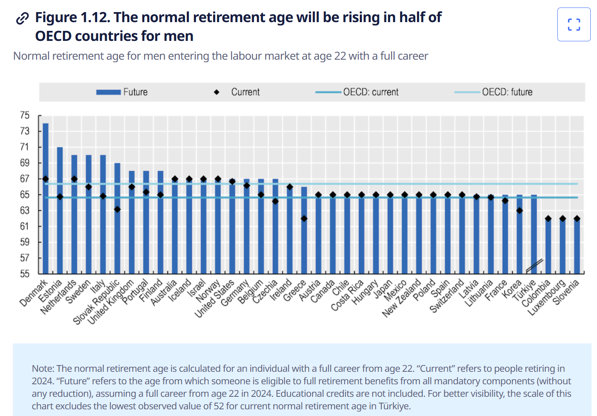
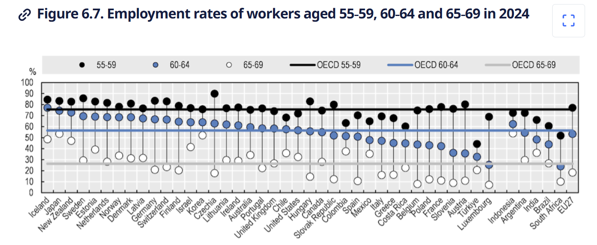

```{r}
#| include: false
library(data.table)
library(ggpubr)
library(scales)
```

## Introduction
- Demographics changes 
- Economic impacts
- Government responses

## Japan population

```{r}
#| echo: false
pop = fread("../data/11 aging/wb_pop.csv")

# Prepare data
pop2 = pop[country=="Japan"]
pop2[,max_value:=max(value),by=indicator]
pop2[,lab:=ifelse(value==max_value,round(value/10^6,0),"")]
pop2_lab = pop2[lab!="",.(value,date,indicator,
                          label=paste0(date,":",
                                       round(value/10^6,0),"M"))]

ggplot(pop2, aes(x = date, y = value,
                color = indicator)) +
  scale_y_continuous(
    labels = label_number(scale = 1e-6, suffix = "M")) +
  geom_line(size = 1) +
  geom_segment(
    data = pop2_lab,
    aes(x = date, xend = date,
        y = 0, yend = value, 
        color = indicator),
    linewidth = 0.7,
    linetype = "dashed"
  ) +
  # labels at top of vline
  geom_text(
    data = pop2_lab,
    aes(x = date, y = value,
        label = label),
    vjust = -0.5,
    size = 3.2
  ) +
  labs(x = "", y = "",
       caption = "Source: WB") +
  theme_minimal() +
  theme(
    legend.position = "top",   # remove legend
    axis.text.x = element_text(angle = 0, hjust = 1))+
  coord_cartesian(clip = "off")        # allow labels to extend outside plot
```

## Driver of population growth

```{r}
#| echo: false
birth = fread("../data/11 aging/un_pop_birth.csv")
birth[, value_norm := value / value[date == min(date)], 
   by = .(Country, variable)]
birth = birth[date<=2050]

ggplot() +
  geom_line(data=birth[!grepl("Life",variable)], 
            aes(x = date, y = value,
                          group = variable,
                          color = variable),size=1) +
  facet_wrap(~Country) +
  labs(x = "", y = "",
       caption = "Source: UN Population Prospect") +
  theme_minimal() +
  theme(
    legend.position = "top",   # remove legend
    axis.text.x = element_text(angle = 90, hjust = 1),
    plot.margin = margin(5, 40, 5, 5)) +
  coord_cartesian(clip = "off")    # allow labels to extend outside plot
```

## Old-age support ratio

```{r}
#| echo: false
age = fread("../data/11 aging/wb_age_depend.csv")

# Prepare data
age[, is_japan := ifelse(country == "Japan", "Japan", "Others")]

# Last observation per country for labeling
lab = age[date==max(date),.(date,value,country,is_japan)]

ggplot(age, aes(x = date, y = value,
                color = is_japan,
                linetype = country,
                group = country)) +
  geom_line(size = 1) +
  geom_text(
    data = lab,
    aes(label = country, color = is_japan),
    hjust = -0.1,              # move label slightly to the right
    vjust = 0.5,
    size = 3
  ) +
  scale_color_manual(values = c("Japan" = "red", "Others" = "gray70")) +
  scale_linetype_manual(
    values = rep(c("solid","dashed","dotdash","twodash","longdash"), 
                 length.out = length(unique(age$country)))
  ) +
  labs(x = "Date", y = "Value",
       caption = "Source: WB. \nNote: Ratio of older dependents--people older than 64--to\n the working-age population--those ages 15-64") +
  theme_minimal() +
  theme(
    legend.position = "none",   # remove legend
    axis.text.x = element_text(angle = 0, hjust = 1),
    plot.margin = margin(5, 40, 5, 5)   # extra right margin so labels not cut
  ) +
  coord_cartesian(clip = "off")        # allow labels to extend outside plot
```


## Economic impacts

- Economic growth: population, participation rate, labor productivity

- Saving rate: larger number of elderly dissavers

- Pension system: PAYGO with a reserved fund

## Economic growth

```{r}
#| echo: false
jpl = fread("../data/11 aging/japan_growth.csv")
jpl[variable=="lf_ratio",variable:="Participation Rate"]
jpl[variable=="pop",variable:="Population"]

ggplot() +
  # Bars for other variables
  geom_col(
    data = jpl[variable != "rgdp"],
    aes(x = period, y = gyoy, fill = variable),
    position = "dodge",
    width = 0.75
  ) +
  # Line for rgdp
  geom_line(
    data = jpl[variable == "rgdp"],
    aes(x = period, y = gyoy, group = 1),
    linewidth = 1.2,
    color = "black") +
  # Axis styling
  labs(
    x = "",
    y = "Growth (YoY, %)",
    fill = "variable"
  ) +
  scale_y_continuous(labels = label_percent(scale = 1)) +
  
  # Nicer theme
  theme_minimal(base_size = 12) +
  theme(
    panel.grid.minor = element_blank(),
    legend.position = "top",
    axis.text.x = element_text(angle = 45, hjust = 1),
    plot.title = element_text(face = "bold", size = 14)
  )

```

## Saving rate

```{r}
#| echo: false
saving = fread("../data/11 aging/wb_saving.csv")

# Prepare data
saving[, is_japan := ifelse(country == "Japan", "Japan", "Others")]

# Last observation per country for labeling
labsave = saving[date==max(date),.(date,value,country,is_japan)]

ggplot(saving, aes(x = date, y = value,
                color = is_japan,
                linetype = country,
                group = country)) +
  geom_line(size = 1) +
  geom_text(
    data = labsave,
    aes(label = country, color = is_japan),
    hjust = -0.1,              # move label slightly to the right
    vjust = 0.5,
    size = 3
  ) +
  scale_color_manual(values = c("Japan" = "red", "Others" = "gray70")) +
  scale_linetype_manual(
    values = rep(c("solid","dashed","dotdash","twodash","longdash"), 
                 length.out = length(unique(saving$country)))
  ) +
  labs(title = "Gross Domestic Saving",
       x = "Date", y = "As percentage of GDP",
       caption = "Source: WB.\n	Note: GDP less final consumption expenditure (total consumption).") +
  theme_minimal() +
  theme(
    legend.position = "none",   # remove legend
    axis.text.x = element_text(angle = 0, hjust = 1),
    plot.margin = margin(5, 40, 5, 5)   # extra right margin so labels not cut
  ) +
  coord_cartesian(clip = "off")        # allow labels to extend outside plot
```

::: notes
- high growth rate is more likely to increase aggregate saving,  constraint on borrowing for the very young increase saving rate (unexpected future growth)
- Underdeveloped Social Security System (Japan after 1973, theoretically sound but not confirmed empirically)
- High cost of housing, down payment (impact not large)
- Intentional bequests
:::

## Saving and Investment

$$
Saving − Investment = {Gov.deficit} + {Trade.surplus}
$$
- high saving rates 

  - high level of investment, faster economic growth
  - finance government deficits 
  - capital outflow, a world lender in long run

## Social spending

```{r}
#| echo: false
social = fread("../data/11 aging/social_spend.csv")
setnames(social,"year","date")
setnames(social,"Country","country")

# Prepare data
social[, is_japan := ifelse(country == "Japan", "Japan", "Others")]

# Last observation per country for labeling
labso = social[date==max(date),.(date,value,country,is_japan)]

ggplot(social, aes(x = date, y = value,
                color = is_japan,
                linetype = country,
                group = country)) +
  geom_line(size = 1) +
  geom_text(
    data = labso,
    aes(label = country, color = is_japan),
    hjust = -0.1,              # move label slightly to the right
    vjust = 0.5,
    size = 3
  ) +
  scale_color_manual(values = c("Japan" = "red", "Others" = "gray70")) +
  scale_linetype_manual(
    values = rep(c("solid","dashed","dotdash","twodash","longdash"), 
                 length.out = length(unique(social$country)))
  ) +
  labs(title= "Public expenditure on cash old-age and survivor benefits as percentage of GDP",
       x = "Date", y = "Value",
       caption = "Source: OECD") +
  theme_minimal() +
  theme(
    legend.position = "none",   # remove legend
    axis.text.x = element_text(angle = 0, hjust = 1),
    plot.margin = margin(5, 40, 5, 5)   # extra right margin so labels not cut
  ) +
  coord_cartesian(clip = "off")        # allow labels to extend outside plot
```

## Pension Contribution Rate

```{r}
#| echo: false
contril = fread("../data/11 aging/social_rate.csv")
contril = contril[grepl("public$|Total",variable)]
contril[,variable:=trimws(gsub("\\,.*$","",variable))]
contril[,value_max:=max(value),by=Country]
cons = unique(contril[order(-value_max),Country])
contril[,Country:=factor(Country,levels = cons)]

ggplot() +
  # Bars for other variables
  geom_col(
    data = contril[variable != "Total"],
    aes(x = Country, y = value, fill = variable),
    position = "dodge",
    width = 0.75
  ) +
  geom_label(data = contril[variable != "Total"],
             aes(x=Country,y=value,label = value)) +
  # Line for rgdp
  geom_line(
    data = contril[variable == "Total"],
    aes(x = Country, y = value, group = 1),
    linewidth = 1.2,
    color = "black") +
  geom_label(data = contril[variable == "Total"],
             aes(x=Country,y=value,label = value)) +
  # Axis styling
  labs(
    x = "",
    y = "Contribution Rate (%)",
    fill = "variable"
  ) +
  scale_y_continuous(labels = label_percent(scale = 1)) +
  # Nicer theme
  theme_minimal(base_size = 12) +
  theme(
    panel.grid.minor = element_blank(),
    legend.position = "top",
    axis.text.x = element_text(angle = 45, hjust = 1),
    plot.title = element_text(face = "bold", size = 14)
  )

```

## Government Responses

- Elderly employment incentives (retirement age extension)

- Promote female labor participation:
  - number of workers
  - gender diversity on productivity growth

- Foreign workers

- Digitization

::: notes
- reduce the benefits
- raise the contribution rates (already 18.3% maximum)
- increase the injection from the general tax revenues
- increase returns on the GPIF portfolio to cash out
:::

## Retirement age extension



## Employment rates of older workers



## Female labor participation

```{r}
#| echo: false
fe = fread("../data/11 aging/oecd_lf.csv")
# Prepare data
fe[, is_japan := ifelse(country == "Japan", "Japan", "Others")]

# Last observation per country for labeling
labfe = fe[date==max(date),.(date,value,country,is_japan,gender)]

ggplot() +
  geom_line(data=fe[is_japan=="Japan"], aes(x = date, y = value,
                linetype = gender),
       color ="red",size=1) +
  geom_line(data=fe[is_japan!="Japan"], aes(x = date, y = value,
                linetype = gender,shape=country),
       color ="gray70",size=1) +
  geom_point(data=fe[is_japan!="Japan"], aes(x = date, y = value,
                shape=country),
       color ="gray50",size=1) +
  facet_wrap(~gender) +
  labs(x = "Date", y = "% labor force participants",
       caption = "Source: OECD") +
  theme_minimal() +
  theme(
    legend.position = "top",   # remove legend
    axis.text.x = element_text(angle = 0, hjust = 1),
    plot.margin = margin(5, 40, 5, 5)   # extra right margin so labels not cut
  ) +
  coord_cartesian(clip = "off")        # allow labels to extend outside plot
```
 
:::notes
- Japanese women have fewer children, out of the labor force for a shorter time
- initiatives to encourage women not to quit their job during the childbearing and child-care years in the 2010s may have been effective
:::  

## Female participation

```{r}
#| echo: false
fe2 = fread("../data/11 aging/oecd_lf_fe.csv")
fe3 = fe2[date%in%c(1975,1985,1995,2005,2015,2024)]
fe3[,date:=as.character(date)]
fe3[,Age:=trimws(gsub("From | years| or","",Age))]

ggplot() +
  geom_line(data=fe3, aes(x = Age, y = value,
                          group = date,
                          color = date),size=1) +
  facet_wrap(~country) +
  labs(x = "Date", y = "% labor force participants",
       caption = "Source: OECD") +
  theme_minimal() +
  theme(
    legend.position = "top",   # remove legend
    axis.text.x = element_text(angle = 90, hjust = 1),
    plot.margin = margin(5, 40, 5, 5)) +
  coord_cartesian(clip = "off")    # allow labels to extend outside plot
```

:::notes
- improve the public support system for child-rearing, 
- gender diversity as a selection criterion for government procurement,
- promotion of women’s empowerment in the private sector, 
- advocacy for work-life balance 
:::

## Female participation vs Fertility Rate

```{r}
#| echo: false
owd = fread("../data/11 aging/owd_fe_fer.csv")
owd[,date:=as.character(Year)]
owd[,Population:=round(population_historical/10^6)]

ggplot() +
  geom_point(data=owd, aes(y = sl_tlf_cact_fe_ne_zs, 
                           x =  fertility_rate,
                           size=Population,
                           colour = date)) +
  facet_wrap(~date) +
  geom_text(data=owd,aes(y = sl_tlf_cact_fe_ne_zs, 
                           x =  fertility_rate,
                         size = Population,
                          label = Code)) +
   scale_y_log10() +   
  scale_x_log10() +
  labs(x = "Fertility Reate", y = "Female participation",
       caption = "Source: ILO, UN, WB") +
  theme_minimal() +
  theme(
    legend.position = "top",   # remove legend
    axis.text.x = element_text(angle = 90, hjust = 1),
    plot.margin = margin(5, 40, 5, 5)) +
  coord_cartesian(clip = "off")    # allow labels to extend outside plot
```

::: notes
- increasing labor participation of women inevitably further reduces the fertility rate
- a negative correlation between female labor participation and fertility in the 1970s and 1980s
- after 1990s the pattern has changed (at least for developed countries)
- constraints on women deciding how to allocate effort and time between home and career
:::

---
## References
<div style="font-size:50%">
- Ito and Hoshi (2020) Chapter 8, 10
- Okamoto, A. (2025). Pension reform for an aging Japan: Welfare and demographic dynamics. Journal of the Japanese and International Economies, 78, 101390. 
- OECD (2025), Pensions at a Glance 2025: OECD and G20 Indicators, OECD Publishing, Paris, https://doi.org/10.1787/e40274c1-en.
- Ellison and Mullin (2014)
- Feyrer, Sacerdote, and Stern (2008) 
- Rosenbluth (2007, 21)
- Data link: 
  - https://databank.worldbank.org/metadataglossary/health-nutrition-and-population-statistics/series/SP.POP.DPND.OL
  - Labour Force Survey (https://www.e-stat.go.jp/)
  - https://www.esri.cao.go.jp/en/sna/data/kakuhou/files/2023/pdf/point_flow_en20241223.pdf
  - https://ourworldindata.org/grapher/fertility-and-female-labor-force-participation?time=1980
</div>

